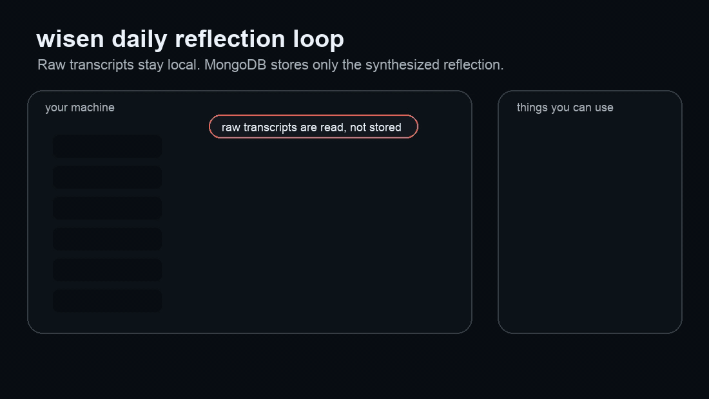
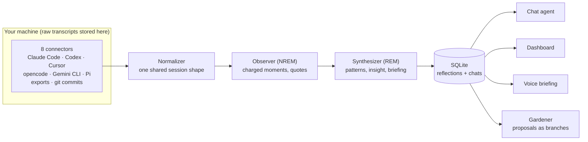

<div align="center">


# wisen

**A continuous-learning harness for coding agents.** It learns from your real
agent sessions: a private daily reflection, a chat you can ask about your work,
and instruction files that keep improving as your agents work.

[](https://github.com/Vela3202019/wisen/actions/workflows/ci.yml) [](LICENSE) [](pyproject.toml) [](https://ai.pydantic.dev)

[Quickstart](#quickstart) · [How it works](#how-it-works) · [Configuration](#configuration) · [Privacy](#what-leaves-your-machine) · [Self-hosting](#your-own-server-optional) · [Contributing](#contributing)

Works with
<a href="https://claude.com/claude-code" title="Claude Code"></a>
<a href="https://openai.com/codex/" title="Codex"></a>
<a href="https://cursor.com" title="Cursor"></a>
<a href="https://github.com/google-gemini/gemini-cli" title="Gemini CLI"></a>
<a href="https://opencode.ai" title="opencode"></a>
<a href="https://pi.dev" title="Pi"></a>

</div>

---

You generate hours of coding-agent transcripts every day: corrections,
rephrases, rejected tool calls, the occasional flow state. Then it all
evaporates. wisen turns that exhaust into a continuous learning loop. It reads
your sessions from Claude Code, Codex, Cursor, opencode, Gemini CLI, Pi, exports
and git commits, synthesizes one *reflection* for the day, and lets you inspect
it through a dashboard, a chat agent, or a voice briefing. The reflection is one
step of the loop: the Gardener reads it and proposes small changes to the
instruction files your agents read, you approve, the change is applied as a
branch, and later sessions show whether it helped. Observe, reflect, propose,
apply, repeat.



Raw transcripts stay where your agents already put them. One local SQLite
file (`~/.wisen/wisen.db`) stores the synthesized reflection, plus your chat
and voice conversations with wisen.

A real reflection, abridged:

```jsonc
// 2026-07-20.json
{
  "your_mood":  { "label": "deep-focus",
    "summary": "Determined execution — dispatched 4 bugs, wrote a design doc,
                reviewed 2 PRs, 5 commits across 5 hours with zero hesitation." },
  "agent_mood": { "label": "confident",
    "summary": "Took ownership without hedging — zero 'I think', zero
                clarifications across 3 sessions, incl. a 213-turn debug session." },
  "alignment_score": 0.85,
  "insight": "The 70% rephrase rate on your end didn't indicate friction — it
              was tight-ship compression the agent could follow.",
  "friction_points": [
    { "type": "unclear-prompt",
      "description": "150 rephrases across 213 turns. The agent handled it,
                      but this is a load pattern worth examining." } ],
  "recommendations": [
    { "target": "workflow",
      "action": "If you switch models mid-session again, note why in a
                 one-liner so the pattern becomes analyzable." } ]
}
```

## Features

- **Eight connectors, one session shape.** Claude Code, Codex, Cursor,
  opencode, Gemini CLI, Pi, generic exports and git commits are normalized
  into one `NormalizedSession`. Connectors tolerate missing directories and
  malformed lines silently, so a broken source never takes down the run.
- **One reflection a day.** An Observer pass extracts the charged moments, a
  Synthesizer pass turns them into moods, friction points, an insight and
  recommendations (see [How it works](#how-it-works)).
- **Chat that investigates.** `POST /chat` talks to an agent grounded in your
  latest reflection, with grep-first search over your raw history and your
  harness configs (see [Chat](#chat)).
- **The Gardener.** Proposes small changes to the `CLAUDE.md`, `AGENTS.md`
  and skill files your agents read. Every change is a git branch you approve
  and merge yourself (see [The Gardener](#the-gardener)).
- **Local-first by construction.** Transcripts flow *through* wisen but are
  never stored *by* it. Everything bound for a server passes one typed
  egress gate (see [What leaves your machine](#what-leaves-your-machine)).
- **Your own server, optional.** A small mailbox server gives you the
  dashboard on your phone as an installable web app, push notifications and
  an approval inbox. It holds no model key and never sees a transcript (see
  [Your own server](#your-own-server-optional)).
- **Any model, or your subscription.** Chat and synthesis use any pydantic-ai
  model string. Synthesis can run on a Claude Pro/Max subscription through
  the Claude Code CLI instead of an API key.
- **No database server.** One SQLite file, created on first use.

## Quickstart

You need one LLM API key (default model: `openai:gpt-5.6-terra`, so
`OPENAI_API_KEY`; any pydantic-ai provider works, see
[Configuration](#configuration)).

```bash
git clone https://github.com/Vela3202019/wisen && cd wisen
pip install -e ".[server]"
export OPENAI_API_KEY=sk-...            # or put it in a repo-root .env
wisen synthesize                        # reflect on yesterday (one real LLM call)
wisen serve                             # API on :8000
```

The full command set:

```bash
wisen synthesize [YYYY-MM-DD]   # ingest sessions + write one day's reflection, then the Gardener batch
wisen serve                     # POST /synthesize, GET /reflections, POST /chat (SSE)
wisen export [dir]              # dump reflections to JSON files
wisen egress                    # what passed the egress gate today
wisen eval <args>               # case bank: mine, list, review, metrics, replay, compare
wisen gardener list|approve|reject|status|run  # Gardener proposals when not paired
wisen worker                    # laptop daemon: syncs with a paired server (outbound only);
                                #   unpaired, runs local Gardener jobs only
wisen cloud pair https://<host> # pair this laptop with your wisen server
wisen cloud serve               # run the server itself (on your server)
wisen migrate-mongo             # one-off: copy a pre-SQLite MongoDB into SQLite
```

`scripts/` has thin wrappers for launchd or cron (`run_synthesis.py`,
`export_reflections.py`, `collect_usage.py`); they bootstrap `sys.path`
themselves and run under system Python.

### Extras

| Extra | Adds |
|---|---|
| `pip install -e ".[server]"` | FastAPI + uvicorn (`wisen serve`) |
| `pip install -e ".[cloud]"` | FastAPI + uvicorn + pywebpush (`wisen cloud serve`, on your server) |
| `pip install -e ".[voice]"` | LiveKit voice agent: the morning briefing, out loud |
| `pip install -e ".[dev]"` | pytest + ruff |
| `pip install -e ".[migrate]"` | pymongo, for the one-off `wisen migrate-mongo` |

## How it works

The pipeline is modeled on sleep, and the metaphor is load-bearing:

- The **Observer** (NREM) reads the day's raw transcripts and extracts the
  emotionally charged moments: rejections, rephrase storms, hedges. The brain
  doesn't replay everything; it replays what mattered.
- The **Synthesizer** (REM) takes those notes and finds cross-day patterns,
  unexpected connections, and the one insight conscious review would miss.
  Its output is your morning briefing.



**Local-first by construction:** transcripts flow *through* wisen but are
never stored *by* it. The SQLite file receives the synthesized reflections,
your chat and voice conversations with wisen, and the job queue. While a
synthesis job runs it checkpoints the Observer's notes for the day there and
drops them when the job succeeds; a failed job keeps them so rerunning the
day retries from there. Raw content stays wherever your agents put it, and
search re-reads the original files (grep-first) at question time. Local
storage is not the same as fully offline: the model calls send excerpts out.
See [What leaves your machine](#what-leaves-your-machine).

Where the code lives:

| Path | What it is |
|---|---|
| `wisen/connectors/` | per-agent parsers, plus `agent_configs.py` for harness and config files |
| `wisen/ingestion/` | pipeline and `NormalizedSession` normalizer |
| `wisen/synthesis/` | Observer and Synthesizer agents, the `claude-cli` adapter, the synthesis job |
| `wisen/chat/` | chat agent and grep-first search tools |
| `wisen/gardener/` | the Gardener agent, allow-list, applier and job loop |
| `wisen/evals/` | case miner, counterfactual replay, metrics |
| `wisen/egress.py`, `wisen/packets.py`, `wisen/redact.py` | the egress gate and typed packets |
| `wisen/cloud/`, `wisen/dashboard/` | the optional server and the web app it serves |
| `wisen/jobs.py`, `wisen/proposals.py`, `wisen/store.py` | durable SQLite job engine, proposal state machine, store |

## Configuration

Copy `config.example.toml` to `~/.wisen/config.toml`; every key is documented
there. Environment variables (or a repo-root `.env`) always override the file.
The three that matter:

- **`model`** (`WISEN_MODEL`): chat model, any pydantic-ai model string. Set
  that provider's API key: `openai:*` needs `OPENAI_API_KEY`, `google:*`
  needs `GEMINI_API_KEY`, `deepseek:*` needs `DEEPSEEK_API_KEY`,
  `anthropic:*` needs `ANTHROPIC_API_KEY`.
- **`synth_model`** (`WISEN_SYNTH_MODEL`): the nightly synthesis, the big
  token spend. Defaults to `model`. Set `"claude-cli:claude-sonnet-5"` to run
  it on a Claude Pro/Max subscription via the Claude Code CLI instead, with
  no API billing (`claude` must be installed and logged in).
- **`[paths]`**: where your agents' dot-dirs and git repos live. Point
  `root_dir` at a synced copy to reflect on another machine.

## Chat

`POST /chat` (SSE) talks to an agent grounded in your latest reflection, with
four tools: fetch any day's reflection, the last 7 days of trends, grep-first
search over your raw session history across all agents, and search over your
harness configs. Ask "how was my week?" and it investigates, reflections first,
then transcripts, then configs, before answering with dates and quotes.

## The Gardener

The Gardener tends the instructions your coding agents read. After a day's
synthesis it reads recent reflections and friction, and proposes small changes
to `CLAUDE.md` files, `AGENTS.md` files and skill files. Nothing else: no repo
code, no settings, no MCP config. The allow-list is a path check in the
applier, not a line in a prompt, so a proposal naming any other path is
refused even after approval.

The loop is propose, approve, apply as a branch, measure weeks later:

1. A proposal carries the diff, a rationale and short evidence quotes. It
   reaches you in the dashboard's approval inbox when paired, or through
   `wisen gardener list` when not.
2. You approve, reject with a note (the note reaches the model on the next
   run), or let it expire after 7 days.
3. An approval becomes a git branch (`wisen/gardener/<proposal id>`) on your
   laptop. wisen never pushes to, or merges into, a default branch; you merge
   when you choose.
4. Two weeks after a merge, the eval loop compares field metrics before and
   after. A change that made things worse gets a revert proposal.

Files outside any repo, such as `~/.claude/CLAUDE.md` and personal skills,
are tracked in a git repo wisen keeps for them (`~/.wisen/gardener/home.git`),
so a proposal there is a branch you merge like any other. The design is in
[docs/plan/cloud-architecture.md](docs/plan/cloud-architecture.md) §5 and the
measurement side in [docs/plan/eval-loop.md](docs/plan/eval-loop.md).

## Your own server (optional)

wisen runs fully on your laptop. Add a small server of your own and you get
the dashboard on your phone as an installable web app, push notifications
when a reflection or a proposal is ready, an approval inbox, and a daily
schedule that runs while you sleep. The server is a mailbox: it never makes a
model call, holds no model key, and never sees raw transcripts. Your laptop
does all model work and only ever connects out to it, with a per-device token
you can revoke.

On the server (one Python process; see [deploy/README.md](deploy/README.md)
for systemd, Caddy and backups):

```bash
pip install "wisen[cloud] @ git+https://github.com/Vela3202019/wisen"
wisen cloud user <name>             # your login (prompts for a password)
wisen cloud vapid-keys              # Web Push keys -> WISEN_VAPID_* env vars
wisen cloud serve                   # 127.0.0.1:8722, behind your HTTPS proxy
```

On the laptop:

```bash
wisen cloud pair https://<host>     # code from the dashboard: Devices -> Add device
wisen worker                        # keep it running with launchd (deploy/launchd/)
```

Network calls from your machine go to the model providers you configure, the
GitHub API (the git commits connector reads your pushes), Anthropic's usage
endpoint (the optional usage collector), and your own wisen server if you
pair one. Nothing else.

## What leaves your machine

There are three tiers. The numbers are the truncation limits in the code.

**1. Data at rest: local.** Raw transcripts, git history, and agent configs stay
where your agents put them. wisen does not copy them. A local SQLite file
holds reflections (plus chat and voice session records).

**2. Model inference: excerpts go to the model provider you configure.**

- **Synthesis** (`wisen/synthesis/agent.py`): the Observer receives every turn
  of the day's sessions, each turn cut to 400 characters. A turn can include
  tool output (for example Claude Code's `[tool_result]` blocks). It also
  receives up to 20 agent config files (CLAUDE.md, AGENTS.md, MCP configs, …),
  each cut to 1,000 characters, plus the day's git commit messages and
  changed-file lists (via the GitHub API). The Synthesizer then receives the
  Observer's notes, which include short quotes, and earlier reflections.
- **Chat** (`wisen/chat/search.py`): each search returns up to 20 matches. A
  match is the matched turn cut to 500 characters, plus one turn before and
  after it, each cut to 200 characters. Config search returns snippets of up
  to 500 characters. These results, and any reflection the agent fetches, go
  to the chat model.
- **Voice** (`[voice]` extra): your speech goes to Google's Gemini realtime
  model.

Pick the provider with `model` and `synth_model`. That provider's data terms
apply to these excerpts. If `synth_model` is `claude-cli:…`, synthesis runs
through the Claude Code CLI and sends the same excerpts to Anthropic under
your own Claude account. The terms of that account apply.

**3. Cloud: derived results only, which can include short quotes.** Everything
bound for a server goes through one egress gate (`wisen/egress.py`) as a typed
packet (`wisen/packets.py`). The gate rejects any packet type or field that is
not on the schema, masks secrets (API keys, tokens, private keys), replaces
email addresses and absolute paths, and caps every text field (quotes at 500
characters, briefings at 4,000).

- A paired wisen server receives what `wisen worker` sends: one result
  packet per reflection, cut down to the result fields; Gardener proposals
  (target file, diff, rationale, short quotes; a diff that would need
  redacting or cutting is not sent at all); what became of each approved
  proposal (its branch name, applied / merged / measured, and the measured
  numbers); one row of numbers per day for the verification loop (user turns,
  corrections, tokens, problems solved; no text); and job status (state,
  times, error class, never a traceback). Results' `evidence` fields and summaries
  can quote short pieces of your sessions word for word. Raw transcripts, the
  full turn excerpts, the Observer's notes, the SQLite file, and API keys
  never go to the server, and the server re-checks every packet against the
  same schema and rejects anything else. `wisen export` and
  `scripts/export_reflections.py` write the same result packets to a folder
  instead, for a sync job of your own.
- `scripts/collect_usage.py` adds a usage packet with subscription usage
  percentages and reset times. To get the Claude percentages, it reads your
  Claude OAuth token from the Keychain and calls Anthropic's usage endpoint.
  Only the percentages and reset times reach the dashboard, not the token.

Every packet that passes the gate is logged in `~/.wisen/egress.log`: time,
destination, packet type, size, field names and a SHA-256 of the bytes, never
the content. `wisen egress` shows today's (`--date`, `--list` for one line per
packet). Packets sent to your server are logged as `cloud:<host>` just before
they leave; the worker sends a packet again only when its content changed.
The export writes packets to a folder that your own sync job (for example
rsync) uploads, so for those the log records what was prepared for upload; a
packet whose content has not changed is not rewritten or logged again.

## Project status

wisen is a personal project under active development; expect the schema and
CLI to move. What exists today and what is planned is written down in
`docs/plan/`:

- [cloud-architecture.md](docs/plan/cloud-architecture.md): the server in
  stage A (local brain, server mailbox) is built and is what `wisen cloud
  serve` runs. Stage B (synthesis split between laptop and server) is a plan.
- [eval-loop.md](docs/plan/eval-loop.md): the case miner, counterfactual
  replay and the gate that measures whether a Gardener change helped.

Upgrading from a MongoDB-backed wisen? Run `pip install -e ".[migrate]"` and
`wisen migrate-mongo` once while MongoDB is still running. It copies your
reflections and chat/voice sessions into the SQLite file. Re-running it is
safe: anything already in SQLite is skipped, never overwritten.

## Tests

Script-style tests, run from the repo root. `python3 -m tests.test_fixtures`
runs offline on committed sample sessions; the full list, what CI runs, and
the tests that read your real local data are in
[CONTRIBUTING.md](CONTRIBUTING.md#dev-setup).

## Contributing

Dev setup, the offline fixture workflow, and a step-by-step guide to adding a
connector for a new coding agent live in [CONTRIBUTING.md](CONTRIBUTING.md).
Connectors are deliberately dumb (find files, parse tolerantly, emit
`NormalizedSession`), so a first contribution is small.

## License

[MIT](LICENSE)
