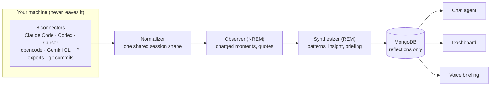

# wisen

**You generate hours of coding-agent transcripts every day — corrections,
rephrases, rejected tool calls, the occasional flow state. Then it all
evaporates.** wisen turns that exhaust into a daily feedback loop: it reads your
real sessions from Claude Code, Codex, Cursor, opencode, Gemini CLI, Pi, exports,
and git commits; synthesizes one private *reflection*; then lets you inspect it
through the dashboard, chat, or a voice briefing.


Run `wisen synthesize`, and wisen walks your local agent history, normalizes the
sessions, finds the charged moments, and writes one reflection for the day. Raw
transcripts stay where they already live; MongoDB stores only the synthesized
reflection.

A real reflection, abridged:

```jsonc
// 2026-07-20.json
{
  "your_mood":  { "label": "deep-focus",
    "summary": "Determined execution — dispatched 4 bugs, wrote a design doc,
                reviewed 2 PRs, 5 commits across 5 hours with zero hesitation." },
  "agent_mood": { "label": "confident",
    "summary": "Took ownership without hedging — zero 'I think', zero
                clarifications across 3 sessions, incl. a 213-turn debug session." },
  "alignment_score": 0.85,
  "insight": "The 70% rephrase rate on your end didn't indicate friction — it
              was tight-ship compression the agent could follow.",
  "friction_points": [
    { "type": "unclear-prompt",
      "description": "150 rephrases across 213 turns. The agent handled it,
                      but this is a load pattern worth examining." } ],
  "recommendations": [
    { "target": "workflow",
      "action": "If you switch models mid-session again, note why in a
                 one-liner so the pattern becomes analyzable." } ]
}
```

## Quickstart

You need a local MongoDB and one LLM API key (default model: `openai:gpt-5.6-terra`
→ `OPENAI_API_KEY`; any pydantic-ai provider works, see Configuration).

```bash
brew services start mongodb-community   # macOS — or: docker run -d -p 27017:27017 mongo
pip install -e ".[server]"
export OPENAI_API_KEY=sk-...            # or put it in a repo-root .env
wisen synthesize                        # reflect on yesterday (one real LLM call)
wisen serve                             # API on :8000
```

```bash
wisen synthesize [YYYY-MM-DD]   # ingest sessions + write one day's reflection
wisen serve                     # POST /synthesize, GET /reflections, POST /chat (SSE)
wisen export [dir]              # dump reflections to JSON files
```

## How it works

The pipeline is modeled on sleep, and the metaphor is load-bearing:

- The **Observer** (NREM) reads the day's raw transcripts and extracts the
  emotionally charged moments — rejections, rephrase storms, hedges — because the
  brain doesn't replay everything; it replays what mattered.
- The **Synthesizer** (REM) takes those notes and finds cross-day patterns,
  unexpected connections, and the one insight conscious review would miss. Its
  output is your morning briefing.



**Local-first by construction:** transcripts flow *through* wisen but are never
stored *by* it. MongoDB receives only the synthesized reflection; raw content
stays wherever your agents put it. Search happens by re-reading the original
files (grep-first) at question time.

## Configuration

Copy `config.example.toml` to `~/.wisen/config.toml` — every key is documented
there. Environment variables (or a repo-root `.env`) always override the file.
The three that matter:

- **`model`** — chat model, any pydantic-ai model string (set that provider's
  API key: `openai:*`, `google:*`, `deepseek:*`, `anthropic:*`, …)
- **`synth_model`** — the nightly synthesis, the big token spend. Defaults to
  `model`; set `"claude-cli:claude-sonnet-5"` to run it on a Claude Pro/Max
  subscription via the Claude Code CLI instead — no API billing
- **`[paths]`** — where your agents' dot-dirs and git repos live; point
  `root_dir` at a synced copy to reflect on another machine

## Chat

`POST /chat` (SSE) talks to an agent grounded in your latest reflection, with
four tools: fetch any day's reflection, the last 7 days of trends, grep-first
search over your raw session history across all agents, and search over your
harness configs. Ask "how was my week?" and it investigates — reflections, then
transcripts, then configs — before answering with dates and quotes.

## Deployment shape

Everything runs on your machine. The optional dashboard (`wisen/dashboard/`,
stdlib-only) lives on a VPS and serves *exported* reflection JSON synced via
rsync — the server never sees raw transcripts, MongoDB, or an API key.
`scripts/` has the thin wrappers meant for launchd/cron.

## Extras

| Extra | Adds |
|---|---|
| `pip install -e ".[server]"` | FastAPI + uvicorn (`wisen serve`) |
| `pip install -e ".[voice]"` | LiveKit voice agent — the morning briefing, out loud |
| `pip install -e ".[dev]"` | pytest + ruff |

## Tests

Script-style tests, run from the repo root:

```bash
python3 -m tests.test_fixtures   # committed sample data — runs anywhere, what CI runs
python3 -m tests.test_claude_cli # subscription-synthesis adapter (no live call)
python3 -m tests.test_ingest     # reads your real local session data
python3 -m tests.test_sources    # per-connector, real local data
python3 -m tests.test_synthesis  # end-to-end: calls the LLM, writes MongoDB
```

## Contributing

Dev setup, the offline fixture workflow, and a step-by-step guide to adding a
connector for a new coding agent live in [CONTRIBUTING.md](CONTRIBUTING.md).
Connectors are deliberately dumb — find files, parse tolerantly, emit
`NormalizedSession` — so a first contribution is small.

## License

MIT
