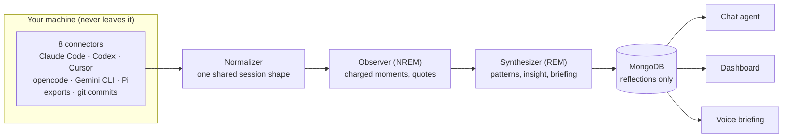

# wisen

**A reflection harness for coding agents.** wisen reads your real coding-agent
sessions — Claude Code, Codex, Cursor, opencode, Gemini CLI, Pi — and synthesizes
a nightly *reflection*: your mood, your agents' mood, where the collaboration had
friction, whether your harness configs are aligned with how you actually work, and
concrete recommendations. A chat agent answers questions about any of it.

You generate hours of transcripts every day: corrections, rephrases, rejected tool
calls, the occasional flow state. Then it all evaporates. wisen is the missing
feedback loop — the richest dataset about how you work with AI, finally read.

## How it works

The pipeline is modeled on sleep, and the metaphor is load-bearing:

- The **Observer** (NREM) reads the day's raw transcripts and extracts the
  emotionally charged moments — rejections, rephrase storms, hedges — because the
  brain doesn't replay everything; it replays what mattered.
- The **Synthesizer** (REM) takes those notes and finds cross-day patterns,
  unexpected connections, and the one insight conscious review would miss. Its
  output is your morning briefing.



**Local-first by construction:** transcripts flow *through* wisen but are never
stored *by* it. MongoDB receives only the synthesized reflection; raw content
stays wherever your agents put it. Search happens by re-reading the original
files (grep-first) at question time.

## Quickstart

You need a local MongoDB and one LLM API key (default model: `openai:gpt-5.6-terra`
→ `OPENAI_API_KEY`; any pydantic-ai provider works, see Configuration).

```bash
brew services start mongodb-community   # macOS — or: docker run -d -p 27017:27017 mongo
pip install -e ".[server]"
export OPENAI_API_KEY=sk-...            # or put it in a repo-root .env
wisen synthesize                        # reflect on yesterday (one real LLM call)
wisen serve                             # API on :8000
```

```bash
wisen synthesize [YYYY-MM-DD]   # ingest sessions + write one day's reflection
wisen serve                     # POST /synthesize, GET /reflections, POST /chat (SSE)
wisen export [dir]              # dump reflections to JSON files
```

## Configuration

Copy `config.example.toml` to `~/.wisen/config.toml`. Environment variables (or a
repo-root `.env`) always override the file.

**Chat model** — any pydantic-ai model string works; set the provider's API key:

```toml
[model]
model = "openai:gpt-5.6-terra"        # OPENAI_API_KEY   (default)
# model = "deepseek:deepseek-v4-flash"  # DEEPSEEK_API_KEY
# model = "google:gemini-2.5-flash"     # GEMINI_API_KEY
# model = "anthropic:claude-sonnet-5"   # ANTHROPIC_API_KEY
```

**Synthesis model** — the nightly synthesis is the big token spend. By default
it runs on the same API model as chat. If you have a **Claude Pro/Max
subscription**, you can route it through the Claude Code CLI instead — no API
billing (`claude` must be installed and logged in):

```toml
synth_model = "claude-cli:claude-sonnet-5"
```

**Paths** — where wisen looks for your data:

```toml
[paths]
root_dir = "~"                  # dir containing the agents' dot-dirs (.claude, .codex, …);
                                # point at a synced copy to reflect on another machine
git_scan_dirs = "~/Developer"   # comma-separated dirs (or specific repos) scanned for
                                # commits and harness files (CLAUDE.md, AGENTS.md, …)
```

## What a reflection contains

One document per day: a weighted **mind map** of topics, **your mood** and the
**agents' mood** (each with evidence quotes), the implicit question each side was
really asking, an **alignment score**, typed **friction points**, up to four
targeted **recommendations** (aimed at a specific file: CLAUDE.md, MCP config,
prompt style…), a **delta layer** (friction resolved/persisting/new, config diffs,
which of yesterday's recommendations you actually followed), and
`synthesis_context` — a 3-paragraph morning briefing that the dashboard shows,
the chat agent grounds itself in, and the voice agent reads aloud.

## Chat

`POST /chat` (SSE) talks to an agent grounded in your latest reflection, with
four tools: fetch any day's reflection, the last 7 days of trends, grep-first
search over your raw session history across all agents, and search over your
harness configs. Ask "how was my week?" and it investigates — reflections, then
transcripts, then configs — before answering with dates and quotes.

## Deployment shape

Everything runs on your machine. The optional dashboard (`wisen/dashboard/`,
stdlib-only) lives on a VPS and serves *exported* reflection JSON synced via
rsync — the server never sees raw transcripts, MongoDB, or an API key. Manual
reflection requests queue as files that your machine picks up when awake.
`scripts/` has the thin wrappers meant for launchd/cron.

## Extras

| Extra | Adds |
|---|---|
| `pip install -e ".[server]"` | FastAPI + uvicorn (`wisen serve`) |
| `pip install -e ".[voice]"` | LiveKit voice agent — the morning briefing, out loud |
| `pip install -e ".[dev]"` | pytest + ruff |

## Tests

Script-style tests, run from the repo root:

```bash
python3 -m tests.test_fixtures   # committed sample data — runs anywhere, what CI runs
python3 -m tests.test_claude_cli # subscription-synthesis adapter (no live call)
python3 -m tests.test_ingest     # reads your real local session data
python3 -m tests.test_sources    # per-connector, real local data
python3 -m tests.test_synthesis  # end-to-end: calls the LLM, writes MongoDB
```

## Contributing

Dev setup, the offline fixture workflow, and a step-by-step guide to adding a
connector for a new coding agent live in [CONTRIBUTING.md](CONTRIBUTING.md).
Connectors are deliberately dumb — find files, parse tolerantly, emit
`NormalizedSession` — so a first contribution is small.

## License

MIT
