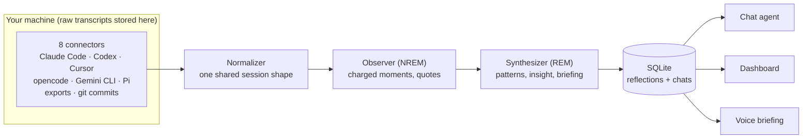

# wisen

**You generate hours of coding-agent transcripts every day — corrections,
rephrases, rejected tool calls, the occasional flow state. Then it all
evaporates.** wisen turns that exhaust into a daily feedback loop: it reads your
real sessions from Claude Code, Codex, Cursor, opencode, Gemini CLI, Pi, exports,
and git commits; synthesizes one private *reflection*; then lets you inspect it
through the dashboard, chat, or a voice briefing.


Run `wisen synthesize`, and wisen walks your local agent history, normalizes the
sessions, finds the charged moments, and writes one reflection for the day. Raw
transcripts stay where they already live; one local SQLite file
(`~/.wisen/wisen.db`) stores the synthesized reflection (plus your chat and
voice conversations with wisen).

A real reflection, abridged:

```jsonc
// 2026-07-20.json
{
  "your_mood":  { "label": "deep-focus",
    "summary": "Determined execution — dispatched 4 bugs, wrote a design doc,
                reviewed 2 PRs, 5 commits across 5 hours with zero hesitation." },
  "agent_mood": { "label": "confident",
    "summary": "Took ownership without hedging — zero 'I think', zero
                clarifications across 3 sessions, incl. a 213-turn debug session." },
  "alignment_score": 0.85,
  "insight": "The 70% rephrase rate on your end didn't indicate friction — it
              was tight-ship compression the agent could follow.",
  "friction_points": [
    { "type": "unclear-prompt",
      "description": "150 rephrases across 213 turns. The agent handled it,
                      but this is a load pattern worth examining." } ],
  "recommendations": [
    { "target": "workflow",
      "action": "If you switch models mid-session again, note why in a
                 one-liner so the pattern becomes analyzable." } ]
}
```

## Quickstart

You need one LLM API key (default model: `openai:gpt-5.6-terra`
→ `OPENAI_API_KEY`; any pydantic-ai provider works, see Configuration). Storage
is a SQLite file wisen creates on first use — no database server to run.

```bash
pip install -e ".[server]"
export OPENAI_API_KEY=sk-...            # or put it in a repo-root .env
wisen synthesize                        # reflect on yesterday (one real LLM call)
wisen serve                             # API on :8000
```

```bash
wisen synthesize [YYYY-MM-DD]   # ingest sessions + write one day's reflection
wisen serve                     # POST /synthesize, GET /reflections, POST /chat (SSE)
wisen export [dir]              # dump reflections to JSON files
wisen egress                    # what passed the egress gate today
wisen migrate-mongo             # one-off: copy a pre-SQLite MongoDB into SQLite
```

Upgrading from a MongoDB-backed wisen? Run `pip install -e ".[migrate]"` and
`wisen migrate-mongo` once while MongoDB is still running. It copies your
reflections and chat/voice sessions into the SQLite file. Re-running it is
safe: anything already in SQLite (by reflection date, chat session or voice
room) is skipped, never overwritten.

## How it works

The pipeline is modeled on sleep, and the metaphor is load-bearing:

- The **Observer** (NREM) reads the day's raw transcripts and extracts the
  emotionally charged moments — rejections, rephrase storms, hedges — because the
  brain doesn't replay everything; it replays what mattered.
- The **Synthesizer** (REM) takes those notes and finds cross-day patterns,
  unexpected connections, and the one insight conscious review would miss. Its
  output is your morning briefing.



**Local-first by construction:** transcripts flow *through* wisen but are never
stored *by* it. The SQLite file receives the synthesized reflections (plus your chat
and voice conversations with wisen); raw content stays wherever your agents
put it. Search happens by re-reading the original files (grep-first) at
question time. Local storage is not the same as fully
offline: the model calls send excerpts out. See below.

## What leaves your machine

There are three tiers. The numbers are the truncation limits in the code.

**1. Data at rest: local.** Raw transcripts, git history, and agent configs stay
where your agents put them. wisen does not copy them. A local SQLite file
holds reflections (plus chat and voice session records).

**2. Model inference: excerpts go to the model provider you configure.**

- **Synthesis** (`wisen/synthesis/agent.py`): the Observer receives every turn
  of the day's sessions, each turn cut to 400 characters. A turn can include
  tool output (for example Claude Code's `[tool_result]` blocks). It also
  receives up to 20 agent config files (CLAUDE.md, AGENTS.md, MCP configs, …),
  each cut to 1,000 characters, plus the day's git commit messages and
  changed-file lists (via the GitHub API). The Synthesizer then receives the
  Observer's notes, which include short quotes, and earlier reflections.
- **Chat** (`wisen/chat/search.py`): each search returns up to 20 matches. A
  match is the matched turn cut to 500 characters, plus one turn before and
  after it, each cut to 200 characters. Config search returns snippets of up
  to 500 characters. These results, and any reflection the agent fetches, go
  to the chat model.
- **Voice** (`[voice]` extra): your speech goes to Google's Gemini realtime
  model.

Pick the provider with `model` and `synth_model`. That provider's data terms
apply to these excerpts. If `synth_model` is `claude-cli:…`, synthesis runs
through the Claude Code CLI and sends the same excerpts to Anthropic under
your own Claude account. The terms of that account apply.

**3. Cloud: derived results only, which can include short quotes.** Everything
bound for a server goes through one egress gate (`wisen/egress.py`) as a typed
packet (`wisen/packets.py`). The gate rejects any packet type or field that is
not on the schema, masks secrets (API keys, tokens, private keys), replaces
email addresses and absolute paths, and caps every text field (quotes at 500
characters, briefings at 4,000).

- The optional dashboard receives what `scripts/export_reflections.py` writes:
  one result packet per reflection, cut down to the result fields. Its
  `evidence` fields and summaries can quote short pieces of your sessions word
  for word. Raw transcripts, the full turn excerpts, the SQLite file, and API
  keys never go to the dashboard.
- `scripts/collect_usage.py` adds a usage packet with subscription usage
  percentages and reset times. To get the Claude percentages, it reads your
  Claude OAuth token from the Keychain and calls Anthropic's usage endpoint.
  Only the percentages and reset times reach the dashboard, not the token.

Every packet that passes the gate is logged in `~/.wisen/egress.log`: time,
destination, packet type, size, field names and a SHA-256 of the bytes, never
the content. `wisen egress` shows today's (`--date`, `--list` for one line per
packet). The export writes packets to a folder that your own sync job (for
example rsync) uploads, so the log records what was prepared for upload; a
packet whose content has not changed is not rewritten or logged again.

## Configuration

Copy `config.example.toml` to `~/.wisen/config.toml` — every key is documented
there. Environment variables (or a repo-root `.env`) always override the file.
The three that matter:

- **`model`** — chat model, any pydantic-ai model string (set that provider's
  API key: `openai:*`, `google:*`, `deepseek:*`, `anthropic:*`, …)
- **`synth_model`** — the nightly synthesis, the big token spend. Defaults to
  `model`; set `"claude-cli:claude-sonnet-5"` to run it on a Claude Pro/Max
  subscription via the Claude Code CLI instead — no API billing
- **`[paths]`** — where your agents' dot-dirs and git repos live; point
  `root_dir` at a synced copy to reflect on another machine

## Chat

`POST /chat` (SSE) talks to an agent grounded in your latest reflection, with
four tools: fetch any day's reflection, the last 7 days of trends, grep-first
search over your raw session history across all agents, and search over your
harness configs. Ask "how was my week?" and it investigates — reflections, then
transcripts, then configs — before answering with dates and quotes.

## Deployment shape

wisen runs on your machine. Network calls go to the model providers (see
[What leaves your machine](#what-leaves-your-machine)), the GitHub API (the
git commits connector reads your pushes), Anthropic's usage endpoint (the usage
collector), and the optional dashboard sync. The optional dashboard (`wisen/dashboard/`,
stdlib-only) lives on a VPS and serves *exported* reflection JSON synced via
rsync — the server never sees raw transcripts, the SQLite file, or an API key.
`scripts/` has the thin wrappers meant for launchd/cron.

## Extras

| Extra | Adds |
|---|---|
| `pip install -e ".[server]"` | FastAPI + uvicorn (`wisen serve`) |
| `pip install -e ".[voice]"` | LiveKit voice agent — the morning briefing, out loud |
| `pip install -e ".[dev]"` | pytest + ruff |
| `pip install -e ".[migrate]"` | pymongo, for the one-off `wisen migrate-mongo` |

## Tests

Script-style tests, run from the repo root:

```bash
python3 -m tests.test_fixtures   # committed sample data — runs anywhere, what CI runs
python3 -m tests.test_claude_cli # subscription-synthesis adapter (no live call)
python3 -m tests.test_store      # SQLite store on a temp file
python3 -m tests.test_ingest     # reads your real local session data
python3 -m tests.test_sources    # per-connector, real local data
python3 -m tests.test_synthesis  # end-to-end: calls the LLM, writes SQLite
```

## Contributing

Dev setup, the offline fixture workflow, and a step-by-step guide to adding a
connector for a new coding agent live in [CONTRIBUTING.md](CONTRIBUTING.md).
Connectors are deliberately dumb — find files, parse tolerantly, emit
`NormalizedSession` — so a first contribution is small.

## License

MIT
