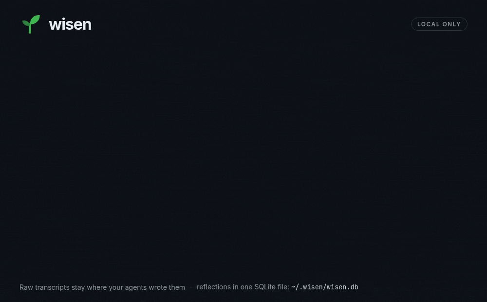

<div align="center">


# wisen

*makes your coding agents wiser every day*

**You've corrected your coding agent on the same thing 40 times this week.
wisen reads your sessions and turns the corrections that keep coming back into
fixes to your `CLAUDE.md` and `AGENTS.md`, each one yours to approve.**



<sub>[Full walkthrough](https://vela3202019.github.io/wisen/)</sub>

```bash
uvx wisen demo          # a sample day in about a second after install; no model call or history read
```

[](https://github.com/Vela3202019/wisen/actions/workflows/ci.yml) [](https://github.com/Vela3202019/wisen/blob/main/LICENSE) [](https://github.com/Vela3202019/wisen/blob/main/pyproject.toml) [](https://ai.pydantic.dev)

<a href="https://claude.com/claude-code" title="Claude Code"></a>
<a href="https://openai.com/codex/" title="Codex"></a>
<a href="https://cursor.com" title="Cursor"></a>
<a href="https://github.com/google-gemini/gemini-cli" title="Gemini CLI"></a>
<a href="https://opencode.ai" title="opencode"></a>
<a href="https://pi.dev" title="Pi"></a>

</div>

---

You spend hours a day with coding agents: corrections, rephrases, rejected
tool calls, the occasional flow state. Then it all evaporates. wisen reads
those sessions where your agents already keep them, writes one *reflection*
for the day, and proposes small fixes to the instruction files your agents
read. You approve each fix, and later sessions show whether it helped.

One of my own days: 213 turns, 150 of them rephrasing something I had already
said. I never counted. wisen did.

## Quickstart

```bash
uv tool install wisen          # or: pipx install wisen (Python 3.11+)
wisen doctor                   # sessions found, model checks, and what to run next
```

If `wisen` isn't on your PATH, run `uv tool update-shell` (or `pipx ensurepath`)
and open a new terminal.

Run the `wisen synthesize` command that `doctor` prints. Without a date,
`wisen synthesize` tries yesterday, then the latest day with sessions in the
past 14 days. To read the saved reflection, run `wisen export ./reflections`
and open `./reflections/YYYY-MM-DD.json` for the date synthesis printed.

The reflection, chat and the Gardener run on your Claude Pro/Max
subscription at no extra cost when the [`claude`](https://claude.com/claude-code)
CLI is installed and logged in (chat and the Gardener switch to OpenAI when
`OPENAI_API_KEY` is set; `wisen doctor` shows which). Prefer an API key? Set `WISEN_SYNTH_MODEL=api`
and `WISEN_MODEL` (for example `openai:gpt-5.6-terra` with `OPENAI_API_KEY`).
Providers beyond OpenAI, Google, and Anthropic may need a pydantic-ai extra.
[Configuration](https://github.com/Vela3202019/wisen/blob/main/docs/configuration.md) covers both routes, and
`wisen doctor` reports missing dependencies or credentials.

Then `wisen serve` starts the API and chat on `:8000` (the `[server]` extra:
`uv tool install "wisen[server]"`). Every command and extra is in
[docs/commands.md](https://github.com/Vela3202019/wisen/blob/main/docs/commands.md); to hack on wisen, see
[CONTRIBUTING.md](https://github.com/Vela3202019/wisen/blob/main/CONTRIBUTING.md).

## Features

- **Eight sources.** Claude Code, Codex, Cursor, opencode, Gemini CLI, Pi,
  generic exports and git commits, read into one session shape.
- **One reflection a day.** Moods, friction points, one insight and
  recommendations. Days with nothing new are skipped.
- **Chat that investigates.** Ask "how was my week?" and it searches your
  reflections, transcripts and configs before answering
  ([docs/chat.md](https://github.com/Vela3202019/wisen/blob/main/docs/chat.md)).
- **The Gardener.** Proposes small changes to your `CLAUDE.md`, `AGENTS.md`
  and skill files. Each one is a git branch you approve and merge yourself
  ([docs/gardener.md](https://github.com/Vela3202019/wisen/blob/main/docs/gardener.md)).
- **Voice briefing.** Hear the morning reflection out loud (the `[voice]` extra).
- **Your own server, optional.** The dashboard on your phone, push
  notifications, an approval inbox and a Telegram bot. It never sees a
  transcript ([docs/server.md](https://github.com/Vela3202019/wisen/blob/main/docs/server.md)).
- **An API model, or your subscription.** Use a pydantic-ai model with its
  provider dependencies and credentials, or your Claude Pro/Max subscription
  through the Claude Code CLI and the Claude Agent SDK.
- **No database server.** One SQLite file (`~/.wisen/wisen.db`), created on
  first use.

## Claude Code plugin

wisen ships as a Claude Code plugin, so the loop lives inside the sessions it
learns from. Install the CLI first (see [Quickstart](#quickstart)), then:

```bash
claude plugin marketplace add Vela3202019/wisen
claude plugin install wisen@vela
```

What it adds:

- **At session start**, one line of context when the Gardener has proposals
  waiting or approved branches you have not merged. Nothing when there is
  nothing to say, and nothing when `wisen` is not installed.
- **`/wisen:proposals`**: the approval inbox in chat. Shows each proposal's
  target, rationale and diff; approves or rejects only the one you name.
- **`/wisen:reflect`**: runs or reads a day's reflection and summarises it.
- **`/wisen:setup`**: installs and configures the CLI on a machine that does
  not have it.

The plugin is the `plugin/` directory; the marketplace is `.claude-plugin/marketplace.json`
at the repo root. `claude plugin validate .` checks both.

## How it works

- **Read.** Connectors parse each agent's on-disk history into one shape and
  skip anything missing or malformed.
- **Observe.** The Observer reads the day's turns and picks out the charged
  moments: rejections, rephrase storms, hedges.
- **Reflect.** The Synthesizer turns those notes into the day's reflection,
  stored in SQLite.
- **Use it.** The chat agent, the dashboard and the voice briefing read the
  reflection; the Gardener turns recurring friction into proposals.
- **Measure.** Two weeks after you merge a proposal, the eval loop compares
  before and after, and proposes a revert if things got worse.

The full pipeline, with a diagram and a map of the code, is in
[docs/how-it-works.md](https://github.com/Vela3202019/wisen/blob/main/docs/how-it-works.md).

A real reflection, abridged:

```jsonc
// 2026-07-20.json
{
  "your_mood":  { "label": "deep-focus",
    "summary": "Determined execution — dispatched 4 bugs, wrote a design doc,
                reviewed 2 PRs, 5 commits across 5 hours with zero hesitation." },
  "agent_mood": { "label": "confident",
    "summary": "Took ownership without hedging — zero 'I think', zero
                clarifications across 3 sessions, incl. a 213-turn debug session." },
  "alignment_score": 0.85,
  "insight": "The 70% rephrase rate on your end didn't indicate friction — it
              was tight-ship compression the agent could follow.",
  "friction_points": [
    { "type": "unclear-prompt",
      "description": "150 rephrases across 213 turns. The agent handled it,
                      but this is a load pattern worth examining." } ],
  "recommendations": [
    { "target": "workflow",
      "action": "If you switch models mid-session again, note why in a
                 one-liner so the pattern becomes analyzable." } ]
}
```

## Privacy

- **Stays on your machine:** raw transcripts, git history and agent configs
  (wisen does not copy them), the SQLite file and your API keys.
- **Goes to the model provider you pick:** excerpts of the day's sessions
  (each turn cut to 400 characters, and a turn can include tool output), up to 20 config
  files, commit messages, and chat search results. Synthesis defaults to
  `claude-cli:…`, and chat and the Gardener to `claude-sdk:…` when no API key
  is set. Both send this to Anthropic under your own Claude account.
  `synth_model = "api"` and an API `model` send it to that provider instead. Voice sends
  your speech to Google's Gemini.
- **Goes to your own server, if you pair one:** derived results, which can
  quote short pieces of your sessions; in stage B also the Observer's notes
  and the text of the files the Gardener may edit, never raw transcripts or
  tool output. Everything passes one egress gate
  that checks a typed schema, masks secrets and caps text length, and
  `wisen egress` shows what left today.

The exact limits, every packet type, stage B, Telegram and the full list of
network calls are in [docs/privacy.md](https://github.com/Vela3202019/wisen/blob/main/docs/privacy.md).

## FAQ

**How is this different from agent memory or editing `AGENTS.md` myself?**
wisen looks for recurring corrections across sessions and agents. It proposes
a diff to your instruction files; you still decide what to merge.

**Does my data leave my machine?** Raw logs stay where your agents wrote them.
Model calls send excerpts to the provider you choose. If you pair a server,
it receives derived results and, in stage B, some extra data. See
[what leaves your machine](https://github.com/Vela3202019/wisen/blob/main/docs/privacy.md).

**Which agents can I use?** Claude Code, Codex, Cursor, Gemini CLI, opencode,
and Pi. wisen also reads generic exports and git commits.

**What does it cost?** wisen is free and the demo makes no model calls. Real
runs can use your Claude Pro/Max plan's limits instead of API billing. If you
use an API key, your provider bills those calls.

## Documentation

- [Configuration](https://github.com/Vela3202019/wisen/blob/main/docs/configuration.md): models, API keys, paths
- [Commands and extras](https://github.com/Vela3202019/wisen/blob/main/docs/commands.md)
- [How it works](https://github.com/Vela3202019/wisen/blob/main/docs/how-it-works.md)
- [Chat](https://github.com/Vela3202019/wisen/blob/main/docs/chat.md)
- [The Gardener](https://github.com/Vela3202019/wisen/blob/main/docs/gardener.md)
- [Your own server](https://github.com/Vela3202019/wisen/blob/main/docs/server.md), with setup details in [deploy/README.md](https://github.com/Vela3202019/wisen/blob/main/deploy/README.md)
- [What leaves your machine](https://github.com/Vela3202019/wisen/blob/main/docs/privacy.md)
- [Development](https://github.com/Vela3202019/wisen/blob/main/docs/development.md): project status, tests, upgrading from MongoDB

## Project status

A personal project under active development; expect the schema and CLI to
move. Plans live in [docs/plan/](https://github.com/Vela3202019/wisen/tree/main/docs/plan/).

## Contributing

Dev setup, offline tests and a guide to adding a connector for a new agent
are in [CONTRIBUTING.md](https://github.com/Vela3202019/wisen/blob/main/CONTRIBUTING.md). Connectors are small, so a first
contribution is too. Please follow the
[Code of Conduct](https://github.com/Vela3202019/wisen/blob/main/CODE_OF_CONDUCT.md), report security problems as
[SECURITY.md](https://github.com/Vela3202019/wisen/blob/main/SECURITY.md) describes, and see [CHANGELOG.md](https://github.com/Vela3202019/wisen/blob/main/CHANGELOG.md) for
what changed in each release.

If wisen is useful, give it a star on GitHub. To help out, see the
[good first issues](https://github.com/Vela3202019/wisen/issues?q=is%3Aissue+is%3Aopen+label%3A%22good+first+issue%22).

## License

[MIT](https://github.com/Vela3202019/wisen/blob/main/LICENSE)
