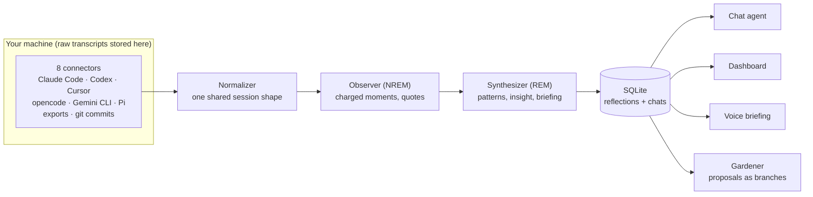

# How it works

The pipeline is modeled on sleep, and the metaphor is load-bearing:

- The **Observer** (NREM) reads the day's raw transcripts and extracts the
  emotionally charged moments: rejections, rephrase storms, hedges. The brain
  doesn't replay everything; it replays what mattered.
- The **Synthesizer** (REM) takes those notes and finds cross-day patterns,
  unexpected connections, and the one insight conscious review would miss.
  Its output is your morning briefing.

## Local-first by construction

Transcripts flow *through* wisen but are
never stored *by* it. The SQLite file receives the synthesized reflections,
your chat and voice conversations with wisen, and the job queue. While a
synthesis job runs it checkpoints the Observer's notes for the day there and
drops them when the job succeeds; a failed job keeps them so rerunning the
day retries from there. Raw content stays wherever your agents put it, and
search re-reads the original files (grep-first) at question time. Local
storage is not the same as fully offline: the model calls send excerpts out.
See [What leaves your machine](privacy.md).

## A day with nothing new is skipped, not reflected on

Wherever a day's run
is asked for (`wisen synthesize`, the launchd script, a paired server's daily
job), a day with no sessions is left alone, and so is a day whose reflection
was already made after its last session ended, so two schedulers asking for
the same day make one reflection. The skip is printed, and a paired server
records it on the job (`skipped: no new sessions`). wisen's own `claude -p`
synthesis runs are not sessions: it never reflects on its own reflection
runs. `wisen synthesize <date> --force`, or the dashboard's Trigger, runs a day
regardless.

## Where the code lives

| Path | What it is |
|---|---|
| `wisen/connectors/` | per-agent parsers, plus `agent_configs.py` for harness and config files |
| `wisen/ingestion/` | pipeline and `NormalizedSession` normalizer |
| `wisen/synthesis/` | Observer and Synthesizer agents, the `claude-cli` adapter, the synthesis job |
| `wisen/chat/` | chat agent and grep-first search tools |
| `wisen/gardener/` | the Gardener agent, allow-list, applier and job loop |
| `wisen/evals/` | case miner, counterfactual replay, metrics |
| `wisen/egress.py`, `wisen/packets.py`, `wisen/redact.py` | the egress gate and typed packets |
| `wisen/cloud/`, `wisen/dashboard/` | the optional server and the web app it serves |
| `wisen/jobs.py`, `wisen/proposals.py`, `wisen/store.py` | durable SQLite job engine, proposal state machine, store |
