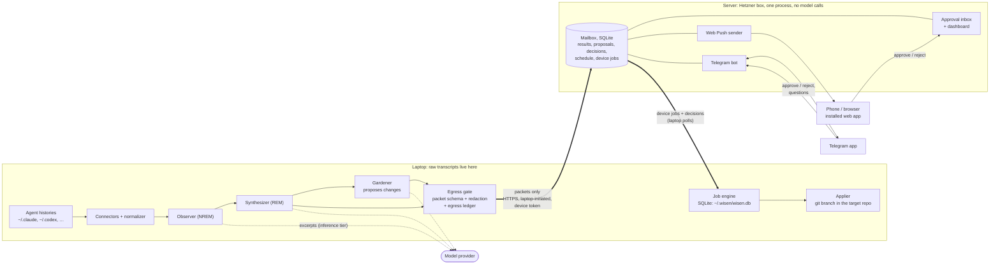
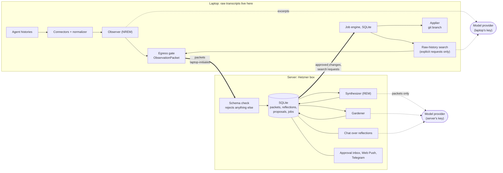
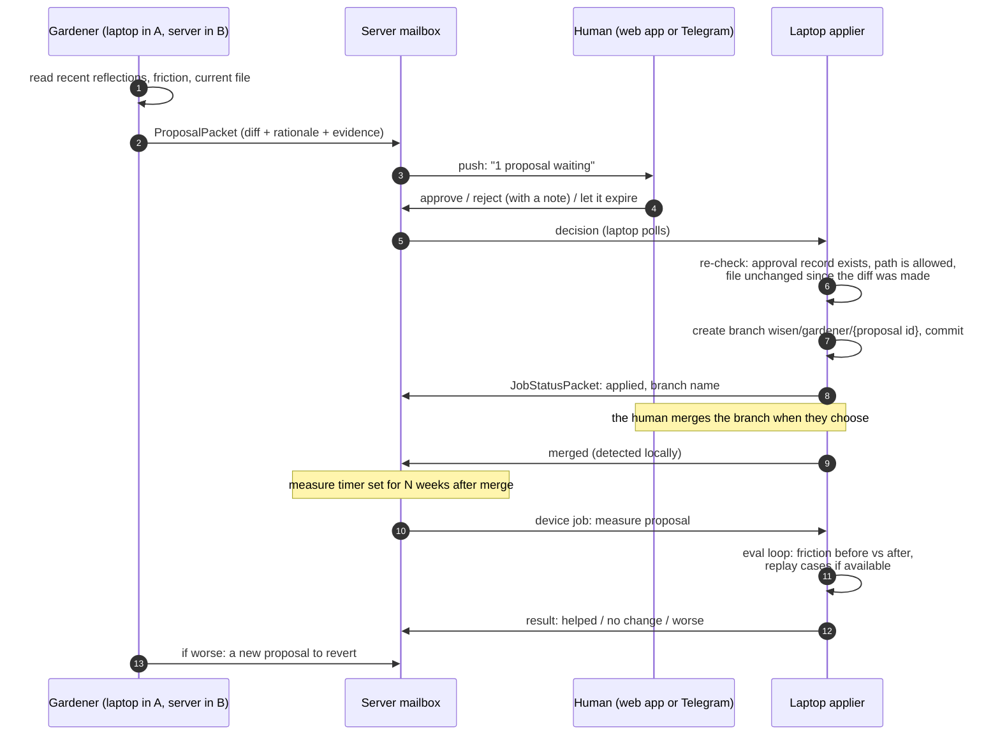
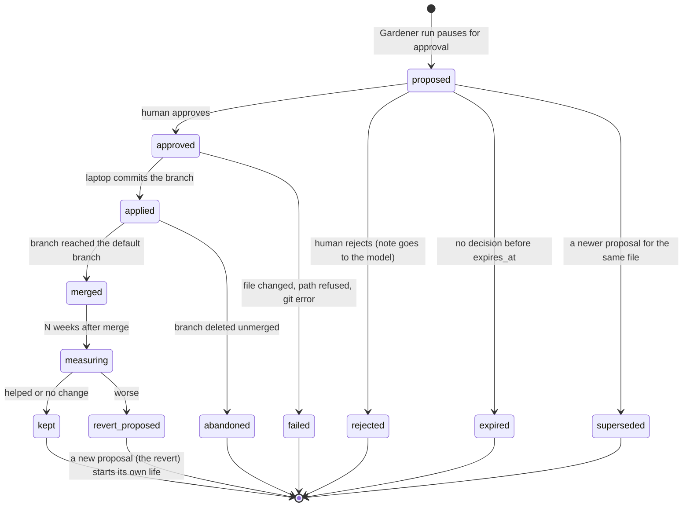

# Cloud architecture: from mirror to Gardener

**Status.** Decided by the owner on 2026-10-18. This doc is the contract that
build steps 1–7 (below) are written against. If a later PR needs to break the
contract, it changes this doc in the same PR.

**Goal.** In the owner's words: "think bold. the goal is to make world-class
open source project - agent harness built from scratch. through which i learned
and explored design orchestration from scratch."

**Privacy rule.** "i care a lot about data privacy. i don't want to upload all
coding logs for user to cloud. the result can be in cloud tho."

**Where the decisions came from.** Three research reports written on
2026-10-18 (commercial cloud products, open agent harnesses, and cloud
infrastructure). They live outside this repo. This doc records only what the
owner decided from them, plus the questions still open
([Open questions](#14-open-questions)).

---

## 1. Summary

- wisen grows from a **mirror** (a daily reflection) into an agent that **acts
  on what it learns**. The acting role is the **Gardener**. It may change only
  `CLAUDE.md`, `AGENTS.md` and skills. Every change is a git branch, and a human
  approves every action. It never touches repo code.
- A small **server** joins the laptop. It is built in two stages ("yes a then b"):
  - **Stage A: local brain, server mailbox.** Every model call runs on the
    laptop. The server holds the schedule, the approval inbox, results and push
    notifications. It makes **no model calls**.
  - **Stage B: the NREM/REM split.** Connectors and the Observer (NREM) stay on
    the laptop and emit typed, redacted **packets**. The Synthesizer and the
    Gardener (REM) move to the server and see packets only.
- **The packet schema is the privacy boundary.** It is enforced in code at both
  ends: the laptop builds packets only through it, and the server rejects
  anything that does not match it.
- **pydantic-ai** (>=2.57.0) runs single agent calls. Everything between calls
  and between machines is built from scratch: a **SQLite job engine** and a
  **proposal state machine**. DBOS is the fallback engine. pydantic-graph is
  never used to save state (its persistence was removed in V2).
- **SQLite everywhere.** MongoDB is retired on the laptop too.
- The server is **one Python process under systemd** on the owner's Hetzner box,
  behind the Caddy that already serves HTTPS, at
  `wisen.vela-server.duckdns.org`. The laptop only ever connects **outbound**,
  with a revocable per-device token.
- You approve from **Web Push** (the dashboard as an installable web app) or
  **Telegram** (notifications, approve/reject buttons, and a chat bot that
  searches history).
- **Each developer self-hosts.** Nothing assumes one user: every stored row
  carries a `user_id`, so a hosted service stays possible later.

---

## 2. Where wisen is today

The design changes these parts of the current code:

| Today | File | What changes |
|---|---|---|
| MongoDB via `motor` for reflections, chat sessions and voice sessions | `wisen/db.py`, used by `wisen/main.py`, `wisen/cli.py`, `wisen/chat/agent.py`, `wisen/voice/agent.py`, `wisen/synthesis/agent.py`, `scripts/export_reflections.py` | Replaced by SQLite (step 1) |
| Chat history stored as text-only `{role, content}`, so tool calls and results are lost between turns | `wisen/main.py` (`/chat`), `wisen/chat/agent.py` | Stored as full pydantic-ai `Conversation`s (step 1) |
| Synthesis jobs in an in-memory dict that a restart loses | `wisen/main.py` (`_jobs`) | Durable job engine (step 3) |
| The daily run is a launchd one-shot | `scripts/run_synthesis.py` | Becomes a scheduled job; launchd only keeps the laptop daemon alive (steps 3–4) |
| A stdlib dashboard on the VPS: exported reflection JSON, a `*.req` file queue for triggers, one shared Basic-auth password | `wisen/dashboard/server.py` | Grows into the server (step 4) |
| What may leave the machine is one allow-list model, `CloudReflection`, guarded by a canary test | `wisen/synthesis/schema.py`, `wisen/export.py`, `tests/test_egress.py` | Becomes the first packet type (step 2) |
| The Observer sends each turn cut to 400 characters to the model provider | `wisen/synthesis/agent.py` (`_format_session`) | Cap may become configurable, up to about 4,000 characters (not yet scheduled; open question 12) |
| Recommendations are typed (`claude-md`, `agents-md`, …) but nothing acts on them | `wisen/synthesis/schema.py` (`Recommendation`) | The Gardener turns them into proposals (step 5) |
| The eval-loop plan auto-applies a config change on a branch when the replay eval improves | `docs/plan/eval-loop.md` (Phase 3) | Superseded: replay results become evidence on a proposal; a human still approves |

---

## 3. The shape: stage A, then stage B

### 3.1 Stage A: local brain, server mailbox

All model work over raw transcripts runs on the laptop, exactly where it runs
today. The server is a mailbox: it stores what the laptop sends, holds what
the human decides, and wakes the laptop up with work. It has no model API key.



Model calls in stage A: **laptop only** (Observer, Synthesizer, Gardener, chat
answers). The server's job is reach and time: it is awake when the laptop is
not, and it is where your phone can find you.

### 3.2 Stage B: NREM on the laptop, REM on the server

The README already describes the pipeline as sleep: the Observer is NREM
(replay the raw day), the Synthesizer is REM (find patterns). Stage B makes
that metaphor the privacy line. NREM touches raw episodes and stays home.
REM works only on consolidated memories (packets) and may run on the server,
so it can "dream" while the laptop sleeps.



Model calls in stage B:

- **Laptop:** the Observer, and raw-history search when you ask for it
  explicitly. These are the only calls that see raw text.
- **Server:** the Synthesizer, the Gardener and reflection chat. They see
  packets only. The server now holds a model API key.

Approved changes are still **applied on the laptop**. The Gardener on the
server writes the proposal; the laptop's applier makes the branch.

### 3.3 What runs where

| Component | Local-only mode | Stage A | Stage B |
|---|---|---|---|
| Connectors, normalizer | laptop | laptop | laptop |
| Observer (NREM) | laptop | laptop | laptop |
| Synthesizer (REM) | laptop | laptop | **server** |
| Gardener: propose | laptop | laptop | **server** |
| Gardener: apply (git branch) | laptop | laptop | laptop |
| Gardener: measure (eval loop) | laptop | laptop | laptop (reads transcripts) |
| Chat over reflections | laptop | laptop, asked via the server | **server** |
| Raw-history search | laptop | laptop | laptop |
| Schedule, approval inbox, push, Telegram | laptop UI only, no push | server | server |
| Job engine | laptop | laptop + server | laptop + server |
| Model API key | laptop | laptop | laptop + server |

**Local-only mode stays first-class.** With no server configured, the laptop
runs everything and you approve in the local dashboard or CLI. The server is
an add-on, never a requirement.

---

## 4. The privacy line

### 4.1 Three tiers

The README's [What leaves your machine](../../README.md#what-leaves-your-machine)
section already names three tiers. This design keeps them and makes the third
one strict:

1. **Data at rest: local.** Raw transcripts stay where the agents wrote them.
   wisen stores derived data only, in `~/.wisen/wisen.db`.
2. **Model inference: excerpts go to the configured provider.** This is true
   today and stays true for the laptop's model calls. The owner allowed larger
   excerpts when they help: "up to 400 characters of every turn can be bigger if
   needed like 4000 char". The per-turn cap can become a setting (default 400,
   ceiling about 4,000). No build step delivers that yet (open question 12).
   Raising it is a measured change: run `wisen eval` before and after, and
   update the README numbers in the same PR.
3. **Cloud: packets only.** The server receives nothing that is not a packet.
   Results may include short verbatim quotes. The owner's call: "original quote
   is fine i guess bc it's not original transcription". Quotes are capped in
   length and pass through redaction like every other field.

A fully local option (an on-laptop model for the Observer, so no provider sees
raw text) is an open question, not part of this plan.

### 4.2 Packets

A packet is a pydantic model that is allowed to leave the laptop. The rule:
**if it is not a packet type, it does not cross.** `CloudReflection` in
`wisen/synthesis/schema.py` is already this pattern (fields listed explicitly,
so a new field stays local until someone decides it may leave). Step 2
generalizes it.

All packet types live in one module that both the laptop and the server import,
so the two ends can never disagree about the schema. From step 2, every
packet carries this envelope:

- `packet_type`
- `schema_version`
- `user_id`
- `packet_id`: a deterministic hash of its content, used for idempotent upload
- `created_at`

`device_id` joins the envelope in step 4, together with device tokens.

| Packet | Stage | Carries | Never carries |
|---|---|---|---|
| `ReflectionPacket` (today's `CloudReflection`) | A | The day's reflection: mood, questions, friction points, recommendations, insight, short evidence quotes | Stage-1 output, raw turns, file paths outside an alias |
| `ProposalPacket` | A | A Gardener proposal: target file (as `project alias + relative path`), the unified diff, rationale, evidence refs and short quotes, eval results if any | The rest of the target repo |
| `JobStatusPacket` | A | Job id, state, timings, error class | Stack traces with local paths or content |
| `AnswerPacket` | A | A chat answer written by a model, with short quotes and dates | Raw search hits |
| `ObservationPacket` | B | What the Synthesizer needs from one day: per-session source, project alias, durations, counts, mood/friction labels, topics, key moments with capped quotes, model usage | Full turns, tool output, code |
| `ConfigSnapshotPacket` | B (open question 7) | Current text of the files the Gardener may edit, secret-redacted | Any other file |

The egress gate on the laptop runs in this order:

1. **Select** only the fields the packet type lists (allow-list). Selecting
   from a stored local document may drop keys the packet does not list, as
   `CloudReflection` does today with `extra="ignore"`.
2. **Redact** free-text and quote values: API keys and tokens
   (secret-detector patterns), absolute home paths (replaced by a project
   alias), email addresses.
3. **Truncate** free-text and quote values, and lists, to their cap.

   Whole-value fields are never redacted or truncated: the `ProposalPacket`
   unified diff, `packet_id` and other identifiers and hashes, the
   `project alias + relative path` target, branch names and state values. They
   go through the same detectors and caps, but a value that redaction would
   change or that is over its cap **rejects the packet**: it stays on the
   laptop and the failure is reported. A human never approves a cut-short or
   rewritten diff.
4. **Validate** by constructing the strict packet model (`extra="forbid"`,
   `max_length` on every string and list). Validation only rejects, never
   shortens: an unknown field or an over-cap value here is a programming error.
5. **Record** the packet in the local egress ledger: `packet_id`, type, byte
   size, field names, hash, time sent. `wisen egress` prints it, so you can see
   what left your machine today.
6. **Send.**

The server validates the wire packet with the same `extra="forbid"` models and
the same caps, and **rejects** anything that fails. That is what "enforced at
both ends" means: a bug on the laptop cannot widen the boundary, because the
server will not store a field it does not know.

> 中文说明：「包」（packet）就是允许离开笔记本的唯一数据形状。笔记本只能用这些类型去打包，打包时先对自由文本和引用脱敏（密钥、绝对路径、邮箱）、再截断长度（diff、ID、路径这类必须完整的字段不改不截，命中就整包拒发、留在本地）、再用严格类型校验、再记一笔出境账本；服务器用同一份类型定义再检查一遍，不认识的字段直接拒收。所以就算笔记本这边有 bug，也没法把原始日志「顺带」传上去。

Durable journals are an egress risk of their own. A job step's saved output is
a stored copy of whatever the step returned. So the Observer step journals its
**packet output**, never the raw turns it read, and any laptop-side journal
that does hold raw text is pruned once its packet is built. Telemetry is
another path out: any agent run that sees raw text uses pydantic-ai
instrumentation with `include_content=False` if traces leave the laptop.

### 4.3 Proving it

`tests/test_egress.py` already plants marker strings and checks that none
reach the exported JSON. The same test grows with each step:

- Step 2: a fixture with a fake API key and an absolute path produces a packet
  with neither; the server-side validator rejects a packet with an extra field.
- Step 4: after a full laptop → server sync of the fixtures, no marker string
  appears anywhere in the server's SQLite file.
- Step 7: with a mock model that echoes its prompt, no marker appears in any
  server-side model prompt.

---

## 5. The Gardener

### 5.1 Scope

The Gardener tends the instructions your coding agents read. It may propose
changes to:

- `CLAUDE.md` files
- `AGENTS.md` files
- skills (files inside a skill directory, such as `.claude/skills/<name>/` or
  `.agents/skills/<name>/`)

Nothing else. **No repo code**, no settings files, no MCP config. The allow-list
is a path check in the **applier** on the laptop, not a line in a prompt, so a
proposal that names any other path is refused even after approval.

Every change lands as a **git branch** that the human approves. wisen never
pushes to, or merges into, a default branch.

### 5.2 The loop

propose → approve → apply as a branch → measure weeks later.



How pydantic-ai fits:

- The Gardener's `propose_change` tool is declared with `requires_approval=True`.
  The run ends with `DeferredToolRequests`. wisen stores the run's
  `Conversation` (with its pending call) in SQLite under the proposal id.
- When the decision arrives, a new run resumes from that stored `Conversation`
  with `DeferredToolResults`: `ToolApproved` or `ToolDenied(message=…)`. A
  rejection note reaches the model, so the next proposal can learn from it.
- Applying is a separate step on the laptop. In stage B the server-side tool
  raises `CallDeferred`, and the laptop's result comes back the same way.
- **Approval is not authorization.** pydantic-ai's own docs say its approval
  flow does not protect against an untrusted client. So the server
  authenticates whoever approves, and the laptop re-checks the stored decision
  and the path allow-list before it writes anything.

> 中文说明：pydantic-ai 的「延迟工具」负责「暂停」：Gardener 想改文件时，本次运行直接结束并保存对话；人可能几小时后在手机上批准，然后用保存的对话 + 审批结果开一个新运行接着走。但「谁有权批准」和「改哪些路径」不能交给模型或这个协议，必须由服务器鉴权、由笔记本上的 applier 再检查一次。

### 5.3 Measuring

Measurement reuses the eval-loop plan (`docs/plan/eval-loop.md`): Tier-1
friction metrics per day, friction half-life, and replay of mined correction
cases where they exist. Two changes to that plan:

- Replay runs **before** a proposal is sent, when cases exist, and its result
  goes into the proposal as evidence. It never applies a change by itself
  (this replaces the automatic accept/revert in eval-loop Phase 3).
- After merge, a timer fires a measure job N weeks later. A "worse" result
  makes the Gardener propose a revert, which goes through the same approval.

Measurement reads transcripts, so it always runs on the laptop.

---

## 6. State: jobs and proposals in SQLite

The owner's decision: a "hand-built state machine in SQLite for proposals and
jobs", with the durable job engine built from scratch ("Build the job engine
myself"), and DBOS as the fallback.

### 6.1 Proposal state machine



Rules:

- **One function moves a proposal**: `transition(proposal_id, from_state,
  to_state, request_id, actor)`. It runs a compare-and-set
  (`UPDATE … WHERE id = ? AND state = ?`) and appends a row to an audit table in
  the same transaction. An illegal or stale transition changes nothing.
- **Decisions are idempotent.** Every decision carries a `request_id`. The same
  approval arriving twice (a Telegram retry, or a tap on both the web app and
  Telegram) returns the first result. The second channel shows "already
  decided".
- **The laptop is the authority for the git states** (`applied`, `merged`,
  `abandoned`) because only it can see the repo. The server is the authority
  for the decision states.

### 6.2 The job engine

One small engine, the same code on the laptop and the server, each with its own
SQLite file. It replaces the in-memory `_jobs` dict in `wisen/main.py`.

| Concept | What it is |
|---|---|
| **Job** | A row: `id`, `user_id`, `kind`, `args` (JSON), `state`, `attempts`, `run_after`, `idempotency_key` (unique), `parent_id`. States: `queued → leased → succeeded / failed → dead` (after max attempts). |
| **Step** | A named, memoized unit inside a job. Its output is saved on success. When a job reruns after a crash, finished steps return their saved output instead of running again. |
| **Lease** | A claim on a job with an expiry. A worker heartbeats to extend it. On startup, and on every scheduler tick, expired leases go back to `queued`. |
| **Timer** | A job with `run_after` in the future. The scheduler sleeps until the earliest one. Wake-ups may repeat, so handlers must be idempotent. |
| **Wait** | A job parked until an event arrives (a decision, a laptop result), with an optional timeout. |
| **Replay policy** | Each step declares whether rerunning it is safe. Reads and model calls are safe to rerun. Side effects (create a branch, send a push) are not: they check a receipt before acting. |

**Two kinds of worker, one queue.** On the server, a job's `runner` column says
who may claim it: the server itself, or a device. The server runs its own jobs
in-process. Device jobs (synthesize a day, apply a proposal, answer a raw
search, measure) are claimed by the laptop over HTTPS with the same lease
rules. A laptop that sleeps mid-job just lets the lease expire, and the job
waits for it to come back.

> 中文说明：「租约」（lease）＝领任务时拿到一张有到期时间的“借条”。干活的进程要定期续期；如果它崩了或笔记本睡着了，借条过期，任务自动回到队列等别人（或醒来的自己）再领。配合「每一步完成就存结果」，重跑时已完成的步骤直接取存档，不会重复调用模型或重复建分支。

**Where pydantic-ai fits.** pydantic-ai runs each agent call. The engine
treats one agent run as one step. A later, optional move plugs the engine in
as a real pydantic-ai durable backend through its public backend builder
(`JournalCallableOperationBackend`), so model and tool calls inside a run are
journaled too. pydantic-graph is not used for state: its persistence was
removed in V2.

**The DBOS fallback.** If the hand-built engine cannot pass the crash tests in
step 3, or keeps costing more time than the features built on it, swap in DBOS
(in-process, SQLite, `DBOSDurability`) behind the same job interface. The
proposal state machine stays hand-built either way.

---

## 7. Storage

**SQLite everywhere; MongoDB is retired.** One file per side:

- laptop: `~/.wisen/wisen.db`
- server: `/var/lib/wisen/wisen.db`

Both use WAL mode. Schema changes are numbered SQL migrations, tracked in a
`schema_version` table.

| Table (laptop) | Replaces | Notes |
|---|---|---|
| `reflections` | Mongo `reflections` | One row per `(user_id, date)`. The full `Reflection` as JSON, plus a few indexed columns. |
| `conversations` | Mongo `chat_sessions` | The pydantic-ai `Conversation` as JSON, so a resumed chat keeps its tool calls and results. |
| `voice_sessions` | Mongo `voice_sessions` | Same fields as today. |
| `jobs`, `job_steps` | `_jobs` dict | The job engine. |
| `proposals`, `proposal_events` | — | The proposal state machine and its audit log. |
| `egress_ledger` | — | Every packet sent. |

The server has the same job and proposal tables, plus `users`, `devices`,
`device_tokens`, `push_subscriptions`, `telegram_links`, and `packets`
(received packets, by type).

**Every row carries `user_id`.** On a laptop that has never paired, it is a
fixed local id. After pairing, the server's id is used.

Moving existing data: a one-time `wisen import-mongo` command reads the old
MongoDB and writes SQLite. After step 1, MongoDB and `motor` are no longer
needed, and the quickstart drops `brew services start mongodb-community`.

---

## 8. The server

### 8.1 On the owner's Hetzner box

The box: Ubuntu, 2 vCPU, 3.7 GiB RAM (about 1.7 GiB free, no swap), no Docker,
Caddy already serving HTTPS, and the wisen dashboard prototype already running
on port 8722. That rules out a MongoDB server, Temporal, and a local model, and
it favours one small process.

```
Caddy (existing, :443, automatic HTTPS)
  └─ wisen.vela-server.duckdns.org → 127.0.0.1:8722
systemd: wisen.service          one process: `wisen cloud serve`, uvicorn, 1 worker
  ├─ dashboard + approval inbox (installable web app, service worker)
  ├─ device API (pairing, packets, job claim/heartbeat/result, decisions)
  ├─ job engine + scheduler (asyncio task in the same process)
  ├─ Web Push sender (VAPID keys)
  ├─ Telegram bot (long polling)
  ├─ stage B only: Synthesizer, Gardener, reflection chat (pydantic-ai, API key)
  └─ /var/lib/wisen/wisen.db (SQLite, WAL)
systemd: wisen-backup.timer     daily, Persistent=true → consistent SQLite snapshot, copied off the box
```

- **One process owns the database and the timers.** No message broker, no
  separate worker fleet on the server: the laptop is the worker.
- It **replaces the dashboard prototype** on port 8722 in place, and binds to
  `127.0.0.1` only. Caddy gets one site block for the hostname.
- The unit runs as a dedicated user with `MemoryMax=` set, so it cannot starve
  the other apps on the box, plus the usual systemd sandboxing
  (`NoNewPrivileges`, `ProtectSystem=strict`, `ReadWritePaths=/var/lib/wisen`).
- **Secrets.** Stage A: device-token hashes, the session secret, VAPID keys and
  the Telegram bot token, in a root-owned `EnvironmentFile`. **No model key.**
  Stage B adds the model provider key to the same file. The Claude subscription
  path (`claude -p`) is not the server's model path (open question 9).
- **Backups** hold packets and results only, never raw transcripts, so off-box
  backup is low-risk. That matters: Claude Code deletes local transcripts after
  30 days by default, so the server's copy becomes the long-term record. Test a
  restore once.

### 8.2 Devices and tokens

- **Pairing.** In the logged-in dashboard, "Add device" shows a one-time code.
  On the laptop, `wisen cloud pair https://<host>` exchanges it for a random
  device token. The server stores only a hash.
- **Use.** The laptop sends `Authorization: Bearer <token>` over TLS. A token is
  scoped to one user and one device.
- **Revoke.** The dashboard lists devices; revoking one makes its next call fail
  with 401.
- **Outbound only.** The laptop daemon (`wisen worker`, kept alive by launchd)
  polls the server for device jobs and decisions. Long-polling first, a
  WebSocket later if needed. The laptop never opens a port.
- **Browser login.** The shared Basic-auth password in
  `wisen/dashboard/server.py` is replaced by a login and a session cookie.

---

## 9. Notifications, approvals and Telegram

### 9.1 Web Push

The dashboard becomes an installable web app (manifest + service worker). It
subscribes to Web Push, and the server sends notifications with `pywebpush`
and VAPID keys. Web Push payloads are end-to-end encrypted between the server
and the browser. On iPhone, Web Push works only after the app is added to the
Home Screen. A notification opens the proposal in the approval inbox.

### 9.2 Telegram

Telegram is a second channel for the same things ("also add support in
telegram"):

- **Linking.** The dashboard shows a one-time code; you send it to the bot.
  The server stores the chat id against your `user_id`. Messages from unlinked
  chats are ignored.
- **Notifications.** New proposals, a finished morning reflection, a measure
  result.
- **Approval buttons.** Approve / Reject buttons on each proposal (inline
  keyboard). A tap becomes a decision with a `request_id`, through the same
  `transition()` as the web app, so both channels stay consistent.
- **History chat** ("can i also add a chatbot where i can search history in
  telegram?"):
  - **By default, it answers from reflections.** In stage A the question is
    queued as a device job, and the laptop's chat agent answers with
    reflection tools only. In stage B the server answers directly.
  - **Raw-history search only on explicit request** (for example a `/search`
    command). It is always a device job, answered by the laptop with the
    existing grep-first search (`wisen/chat/search.py`). What comes back is an
    `AnswerPacket` (a written answer with short quotes), never raw hits.
  - If the laptop is asleep, the bot replies that the question is queued, and
    answers when the laptop wakes.

The server reaches Telegram with long polling, so the bot needs no extra public
endpoint. Telegram stores bot chats on its own servers (they are not end-to-end
encrypted), which is why how much detail a Telegram message carries is listed
as open question 8.

---

## 10. Self-hosting and multi-user readiness

The owner: "each self-hosts for now", with a possible hosted service later.

- **Each developer runs their own server**, with their own keys. wisen never
  holds another person's data.
- **Nothing Hetzner-specific in the app.** Config is environment-only (data
  dir, public URL, keys). The repo ships samples in `deploy/`: a systemd unit,
  a backup timer and a Caddyfile snippet.
- **Multi-user-ready, single-user-run.** Every row has `user_id`; every token,
  push subscription and Telegram link is scoped to one user; no query reads
  across users. A hosted service would still need real per-tenant work
  (encryption at rest, API keys per tenant, never subscription credentials),
  and it is not part of this plan.
- The device protocol is plain JSON over HTTPS, so another server
  implementation could replace this one later.

---

## 11. pydantic-ai: what is used, what is built

| Piece | Use from pydantic-ai | Build in wisen |
|---|---|---|
| Agent calls | `Agent`, structured output, tools | — |
| Approval pause | `requires_approval=True`, `DeferredToolRequests` / `DeferredToolResults`, `ToolApproved` / `ToolDenied` | Approval inbox, push, Telegram, authentication, the proposal state machine |
| Work on another machine | `CallDeferred` (stage B Gardener → laptop applier) | Device jobs, leases, the applier |
| Saving a paused run or a chat | `Conversation` + `ConversationTypeAdapter`, stored as JSON in SQLite | — |
| Durable jobs | Later and optional: the durable-backend builder, to journal inside a run | The job engine (fallback: `DBOSDurability`) |
| Multi-agent | Plain programmatic hand-off (Observer → Synthesizer → Gardener) | Which agent runs on which machine, and the packet hand-off between them |
| Telemetry | `InstrumentationSettings(include_content=False)` when traces leave the laptop | — |
| Graph state | Not used (pydantic-graph persistence was removed in V2) | — |

---

## 12. Build order

Each step leaves a working wisen. Local-only mode keeps working after every
step.

| Step | Delivers | Verified by |
|---|---|---|
| **0. This design doc** | `docs/plan/cloud-architecture.md` with the system, approval-flow and state-machine diagrams | Diagrams render on GitHub; owner review |
| **1. SQLite on the laptop** | A storage module replacing `wisen/db.py` and every Mongo call site; chats stored as `Conversation`s; `wisen import-mongo`; `motor` removed; README and CLAUDE.md run instructions without MongoDB | All tests pass with no MongoDB running; importing a real Mongo database gives the same reflection count; a resumed chat still sees its earlier tool results |
| **2. Packet boundary** | Shared packet models (starting from `CloudReflection`); the packet envelope (`packet_type`, `schema_version`, `user_id`, `packet_id`, `created_at`); the egress gate (allow-list → redact → truncate → validate → ledger → send); `wisen egress` | `tests/test_egress.py` extended: a fixture with a fake API key and an absolute path yields a packet with neither; a packet with an extra field fails validation; a proposal whose diff is over its cap or contains a secret is rejected, not cut or rewritten |
| **3. Job engine + proposal state machine** | `jobs`/`job_steps` with leases, timers, waits and replay policies; `transition()` with audit; `_jobs` in `wisen/main.py` and the launchd synthesis run moved onto it | Kill the process between Observer and Synthesizer, restart: the Observer is not called again and exactly one reflection is stored; a duplicate `idempotency_key` returns the existing job; an illegal transition changes nothing; an expired lease is requeued on startup |
| **4. Server, stage A** | `wisen cloud serve` replacing `wisen/dashboard/server.py`; login, pairing, device tokens; the mailbox and device-job API; approval inbox; installable web app with Web Push; `device_id` in the packet envelope; `wisen worker` on the laptop; `deploy/` samples; backup timer | On the Hetzner box: pair the laptop; a day's reflection arrives and the phone gets a push; a revoked token gets 401; a server restart mid-lease recovers the job; a restored backup serves the same data; the server's environment has no model key; no fixture marker string appears in the server database |
| **5. Gardener loop** | The Gardener agent and its `requires_approval` tool; proposals from reflections; the laptop applier (allow-list, branch `wisen/gardener/<id>`); merge detection; the measure timer wired to the eval loop | An approved proposal produces exactly one commit on one branch even if the laptop reconnects mid-apply; a proposal for a disallowed path is refused after approval; a rejection note reaches the next run; a measure job fires after merge and records its result |
| **6. Telegram** | Bot linking, notifications, approve/reject buttons, history chat (reflections by default, `/search` on the laptop) | Approving in Telegram and then in the web app records one decision; an unlinked chat is ignored; `/search` while the laptop sleeps is answered after it wakes |
| **7. Stage B** | `ObservationPacket` upload; Synthesizer, Gardener and reflection chat on the server over packets; model key on the server; applying still on the laptop | With the laptop asleep, the morning reflection is produced from packets already uploaded; with a mock model that echoes its prompt, no fixture marker appears in any server-side prompt or row |

---

## 13. Out of scope

- The Gardener editing repo code, settings files or MCP config.
- Merging branches. wisen creates them; you merge them.
- Hosting other developers' data on the owner's server.
- A model running on the Hetzner box (no GPU, little RAM).

---

## 14. Open questions

The research raised these and the owner has not decided them. Each names the
step that needs the answer.

1. **Tailscale or public HTTPS for the device API?** The design works with
   public HTTPS plus device tokens. Tailscale would hide the device API from the
   internet, but every device (including a phone, if approvals go over the
   tailnet) needs the client. *Needed by step 4.*
2. **Hostname.** `wisen.vela-server.duckdns.org` needs to resolve (DuckDNS
   sub-subdomains were not verified). Fallback: a path on
   `vela-server.duckdns.org` with tightly scoped cookies, which shares an origin
   with the other apps on the box. *Step 4.*
3. **A local-model Observer?** An on-laptop model (for example through
   pydantic-ai's Ollama provider) would keep raw text away from every provider.
   Quality is unknown until measured with `wisen eval`. Should it be offered,
   and should it ever be the default? *Any time after step 2.*
4. **Several machines.** Should one day's reflection merge packets from several
   laptops on the server, or stay one reflection per machine? *Step 7.*
5. **Vendor clouds as hands.** May an approved proposal be carried out by a
   vendor's cloud agent (Claude routines, Codex cloud), given those vendors would
   see and store the proposal? Not planned; listed so it is decided on purpose.
6. **Files outside a git repo.** `~/.claude/CLAUDE.md` and personal skills
   often are not in a repo. Should the Gardener require a dotfiles repo, keep a
   wisen-managed git repo for them, or skip them? *Step 5.*
7. **What the stage B Gardener may see.** To write a diff on the server it needs
   the current file text (`ConfigSnapshotPacket`). The alternative is that the
   server Gardener writes the intent and the laptop drafts the diff, which keeps
   file text home but adds a laptop model call. *Step 7.*
8. **How much a Telegram message carries.** Title and a link to the web app, or
   the full proposal and diff? Telegram stores bot chats on its servers. *Step 6.*
9. **`claude -p` on the server.** It is the owner's own box, so the owner's
   subscription rule may allow it for the owner's use, but it adds a Node CLI of
   unmeasured memory size and consumer data terms. Stage B assumes an API key
   unless this changes. *Step 7.*
10. **Timing.** How long a proposal stays open before it expires, and how many
    weeks after merge to measure. *Step 5.*
11. **Proposal batching.** One approval per proposal, or a daily batch you
    approve item by item? *Step 5.*
12. **When to make the Observer's per-turn cap configurable.** The owner
    accepts excerpts up to about 4,000 characters per turn, but no build step
    delivers the setting yet. Which step should, and what should the default be
    once `wisen eval` has compared the sizes?
